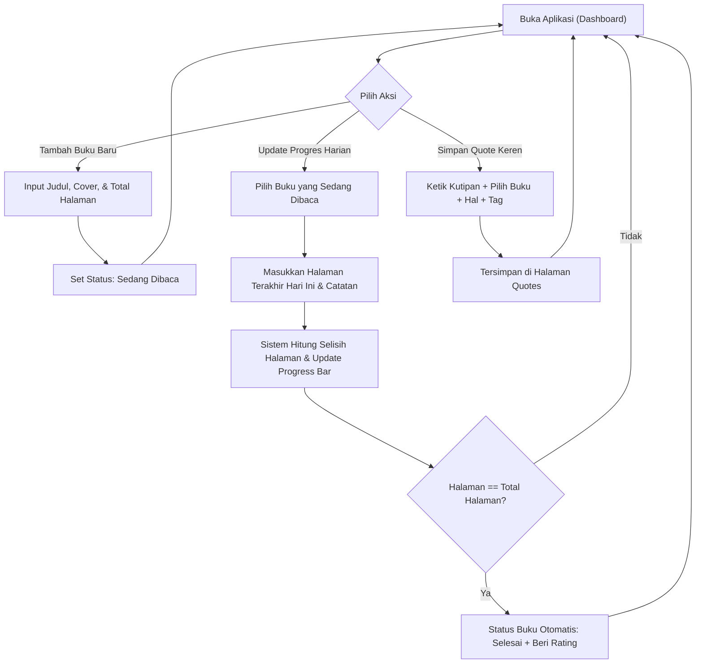
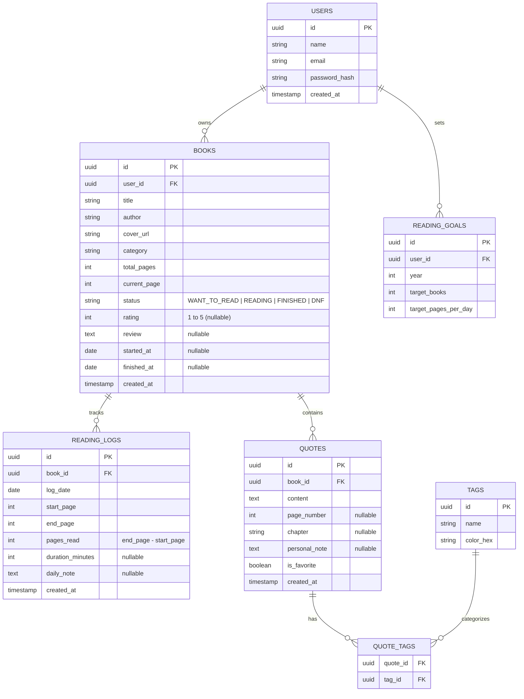

# Product Requirements Document (PRD): Aplikasi Web Book Reading Tracker

## 1. Ringkasan Produk (Product Overview)
**Nama Proyek (Usulan):** Marginalia
**Platform:** Aplikasi Web (Responsive Desktop & Mobile)  
**Deskripsi Singkat:**  
Aplikasi web pelacak aktivitas membaca buku pribadi yang membantu pengguna mengelola koleksi buku, mencatat progres halaman yang dibaca setiap hari, membangun konsistensi membaca (*reading habit*), serta menyimpan dan mengorganisir kutipan (*quotes*) menarik dari buku yang dibaca dalam satu tempat yang terstruktur.

> [!NOTE]
> Fokus utama aplikasi ini adalah memberikan pengalaman mencatat progres harian dan menyimpan *quotes* secara cepat (kurang dari 30 detik per sesi) dengan tampilan visual yang bersih dan memotivasi lewat halaman **Dashboard**.

---

## 2. Masalah & Tujuan (Objectives)
1. **Visualisasi Progres:** Pembaca sering lupa sudah sampai halaman berapa atau kehilangan motivasi karena tidak melihat perkembangan bacaan harian mereka.
2. **Penyimpanan Quotes Terpusat:** Kutipan bagus di buku sering kali hanya difoto atau digarisbawahi, lalu terlupakan dan sulit dicari kembali saat dibutuhkan.
3. **Konsistensi Harian:** Membantu pengguna melihat riwayat membaca dari hari ke hari (apakah hari ini sudah membaca atau belum, dan berapa halaman yang diselesaikan).

---

## 3. Fitur Utama & Modul Sistem (Core Features)

### 3.1. Halaman Dashboard (Command Center)
Halaman utama yang langsung terlihat saat pengguna membuka aplikasi. Berisi ringkasan aktivitas dan akses cepat:
* **Sedang Dibaca (*Currently Reading Spotlight*):**
  * Menampilkan **Cover Buku**, **Judul**, dan **Penulis** dari buku yang berstatus *Sedang Dibaca*.
  * **Progress Bar Visual:** Menampilkan posisi halaman saat ini dibanding total halaman (contoh: `Hal. 142 / 320 (44%)`).
  * **Tombol Aksi Cepat (`+ Update Bacaan Hari Ini` & `+ Simpan Quote`):** Modal/pop-up instan tanpa perlu berpindah halaman.
* **Statistik Ringkas (*Quick Stats Cards*):**
  * **Reading Streak:** Jumlah hari berturut-turut membaca (contoh: `7 Hari Beruntun`).
  * **Halaman Hari Ini / Minggu Ini:** Total halaman yang berhasil dibaca hari ini dan akumulasi minggu ini.
  * **Buku Selesai (*Finished Books*):** Jumlah buku yang tamat tahun ini dibandingkan dengan target (*Reading Goal*).
* **Kalender / Grafik Aktivitas Harian (*Daily Reading Tracker*):**
  * Grafik batang (*bar chart*) 7–30 hari terakhir atau *heatmap* kalender yang menunjukkan jumlah halaman yang dibaca pada setiap tanggal.
* **Quote Spotlight (*Kutipan Pilihan*):**
  * Menampilkan 1 kutipan acak (*random quote*) dari koleksi *quotes* yang pernah disimpan pengguna sebagai pengingat/inspirasi harian.

---

### 3.2. Manajemen Koleksi Buku (My Library / Rak Buku)
Halaman untuk mengelola seluruh buku yang dimiliki atau ingin dibaca:
* **Kategori Rak (Status Buku):**
  1. `Sedang Dibaca (Currently Reading)`
  2. `Ingin Dibaca (Want to Read / Wishlist)`
  3. `Selesai Dibaca (Finished)`
  4. `Berhenti Sementara / Tidak Dilanjutkan (On Hold / DNF)`
* **Data Buku:**
  * Cover Buku (bisa melalui upload gambar lokal atau link URL gambar).
  * Judul Buku, Nama Penulis, Genre/Kategori, dan Total Halaman.
  * Tanggal Mulai Baca & Tanggal Selesai Baca (terisi otomatis saat status berubah).
  * Rating (1–5 Bintang) & Ulasan/Kesimpulan Pribadi setelah buku selesai dibaca.
* **Fitur Opsional (Pencarian Otomatis):** Integrasi dengan *Google Books API* atau *OpenLibrary API* sehingga pengguna cukup mengetik judul buku, lalu Cover, Penulis, dan Total Halaman terisi otomatis.

---

### 3.3. Pelacakan Bacaan Harian (Daily Reading Log)
Sistem untuk mencatat "sudah sampai mana bacanya di setiap harinya":
* **Cara Kerja Pencatatan Harian:**
  * Pengguna memilih buku yang sedang dibaca, lalu memasukkan **Halaman Terakhir yang Dicapai** hari ini (contoh: kemarin di halaman `50`, hari ini selesai di halaman `85`).
  * Sistem secara otomatis menghitung selisihnya: **`+35 halaman dibaca hari ini`** dan memperbarui *progress bar* buku tersebut menjadi `85 / Total Halaman`.
  * Jika halaman akhir sama dengan `Total Halaman`, sistem otomatis menawarkan untuk mengubah status buku menjadi **Selesai Dibaca**.
* **Detail Log Harian:**
  * Tanggal baca (default: hari ini, namun bisa memilih tanggal kemarin jika lupa mencatat).
  * Halaman awal & halaman akhir.
  * Durasi membaca dalam menit (opsional).
  * Catatan singkat harian (*Daily Note*, misal: *"Bab 4 seru banget, membahas tentang cara kerja kebiasaan"*).
* **Timeline Riwayat per Buku:**
  * Di halaman detail buku, terdapat daftar riwayat dari hari ke hari sejak pertama kali buku mulai dibaca hingga tamat.

---

### 3.4. Halaman Quotes Buku (Quotes Vault)
Halaman khusus untuk mengoleksi, mencari, dan menikmati kutipan-kutipan keren dari buku:
* **Pencatatan Quote:**
  * **Isi Kutipan (*Quote Text*):** Teks kutipan dari buku.
  * **Sumber Buku:** Terhubung langsung dengan buku di database (otomatis menampilkan cover kecil dan judul buku pada kartu quote).
  * **Letak Kutipan:** Nomor halaman dan/atau nama bab.
  * **Catatan / Refleksi Pribadi (*Opsional*):** Pemikiran pengguna tentang maksud kutipan tersebut.
  * **Tag / Topik:** Label kategori seperti `#filosofi`, `#motivasi`, `#karir`, `#romansa`, `#produktivitas`.
  * **Tombol Favorit (*Pin/Star*):** Menandai kutipan paling berkesan.
* **Eksplorasi & Tampilan Quotes:**
  * Tampilan berbentuk *Masonry Grid* (kartu-kartu estetik berisi teks kutipan, nomor halaman, serta info & cover buku).
  * **Filter & Pencarian:** Cari berdasarkan kata kunci, filter berdasarkan buku tertentu, filter berdasarkan `#tag`, atau hanya tampilkan yang difavoritkan.
  * **Mode Kartu Shareable (Bonus):** Tombol untuk memperbesar quote menjadi kartu visual yang rapi untuk di-screenshot atau diunduh sebagai gambar.

---

## 4. Alur Pengguna (User Flow)

---

## 5. Rancangan Database (Database Schema / ERD)

Aplikasi ini menggunakan database relasional (seperti **PostgreSQL**, **MySQL**, atau **SQLite**) agar relasi antara buku, log harian, dan kutipan tercatat dengan rapi.

> [!TIP]
> Jika aplikasi ini hanya digunakan untuk kebutuhan pribadi (*single-user*) di komputer lokal, tabel `USERS` dapat disederhanakan atau dihilangkan terlebih dahulu pada tahap MVP agar pengembangan jauh lebih cepat.

---

## 6. Struktur Halaman (Sitemap & Navigasi UI)

Navigasi utama menggunakan *Sidebar* (di Desktop) atau *Bottom Navigation* (di Mobile) yang terdiri dari 4 menu utama:

| Menu / Halaman | Path URL | Fungsi Utama |
| :--- | :--- | :--- |
| **1. Dashboard** | `/` | Melihat buku yang sedang dibaca, tombol cepat log harian, statistik *streak*, grafik bacaan harian, dan *quote of the day*. |
| **2. Koleksi Buku** | `/books` | Melihat semua buku dengan tab filter (`Sedang Dibaca`, `Ingin Dibaca`, `Selesai`), serta tombol tambah buku baru. |
| **3. Detail Buku** | `/books/[id]` | Melihat detail satu buku, riwayat bacaan harian (*timeline log*) khusus buku tersebut, dan kumpulan *quotes* dari buku itu saja. |
| **4. Quotes Keren** | `/quotes` | Galeri seluruh kutipan buku yang disimpan, lengkap dengan fitur pencarian, filter per buku, filter `#tag`, dan tambah quote. |
| **5. Riwayat / Kalender** | `/logs` | *(Opsional)* Melihat kalender aktivitas membaca dari hari ke hari secara lengkap beserta catatan harian. |

---

## 7. Rekomendasi Tech Stack

Berikut adalah beberapa pilihan teknologi yang sangat cocok untuk membangun aplikasi ini:

1. **Opsi 1: Modern Full-Stack JavaScript (Sangat Direkomendasikan)**
   * **Framework:** Next.js (App Router) atau Remix
   * **Styling & UI:** Tailwind CSS + `shadcn/ui` + Lucide Icons (memberikan tampilan dashboard yang bersih dan modern dengan cepat)
   * **Database:** SQLite (lokal, sangat mudah tanpa setup server) atau PostgreSQL (via Supabase / Neon jika ingin online)
   * **ORM:** Prisma atau Drizzle ORM
2. **Opsi 2: Backend & Frontend Terpisah / Klasik**
   * **Frontend:** React (Vite) atau Vue.js + Tailwind CSS
   * **Backend:** Node.js (Express/Fastify) atau Python (FastAPI) atau PHP (Laravel)
   * **Database:** MySQL atau PostgreSQL

---

## 8. Tahapan Pengembangan (MVP Roadmap)

Agar tidak bingung saat mulai membuat kodenya, pengerjaan dibagi menjadi 3 tahap:

### Tahap 1: Minimum Viable Product (MVP) — *Fokus Utama*
- [ ] Setup project dan skema database (`books`, `reading_logs`, `quotes`).
- [ ] Fitur tambah buku (beserta input URL cover/upload cover) & ubah status buku.
- [ ] Fitur catat bacaan harian (*Daily Log*) yang otomatis meng-update `current_page` dan *progress bar* buku.
- [ ] Halaman **Quotes** untuk menambah, melihat, dan memfilter kutipan berdasarkan buku.
- [ ] Halaman **Dashboard** yang menampilkan buku yang sedang dibaca, total buku selesai, halaman terbaca hari ini, dan 1 quote acak.

### Tahap 2: Visualisasi & Kenyamanan (Enhancement)
- [ ] Grafik bacaan harian (7 hari terakhir) dan perhitungan *Reading Streak* di Dashboard.
- [ ] Sistem `#tag` dan pencarian kata kunci pada halaman Quotes.
- [ ] Integrasi *Google Books API* / *OpenLibrary API* untuk pencarian judul & cover buku otomatis.

### Tahap 3: Fitur Tambahan (Polish)
- [ ] Target membaca tahunan/harian (*Reading Goal Tracker*).
- [ ] Fitur *Dark Mode* & export kutipan buku menjadi kartu gambar.
